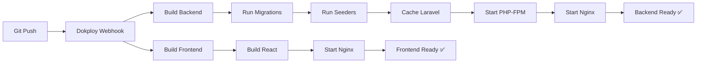

# ✅ Resumen de Configuración Docker - Petrotekno

## 📦 Archivos Creados

### Backend (Laravel) - `/petrotekno-cms/`
- ✅ `Dockerfile` - Imagen PHP 8.2 + Nginx + SQLite
- ✅ `nginx.conf` - Configuración Nginx (Puerto 8080)
- ✅ `docker-entrypoint.sh` - Script de inicio automático
- ✅ `.dockerignore` - Exclusión de archivos innecesarios
- ✅ `.env.production.example` - Template de variables

### Frontend (React) - `/webpetrotekno/`
- ✅ `Dockerfile` - Multi-stage build (Node 20 + Nginx)
- ✅ `nginx.conf` - Configuración para SPA (Puerto 80)
- ✅ `.dockerignore` - Exclusión de node_modules, etc.

### Documentación
- ✅ `DOKPLOY_DEPLOYMENT_GUIDE.md` - Guía paso a paso
- ✅ `DOCKER_README.md` - Documentación técnica

---

## 🎯 Configuración en Dokploy

### Aplicación 1: Backend
```yaml
Nombre: petrotekno-backend
Tipo: Application from Git
Build Path: petrotekno-cms
Dockerfile: ./Dockerfile
Puerto: 8080
```

**Variables de Entorno Requeridas:**
```env
APP_NAME=Petrotekno CMS
APP_ENV=production
APP_KEY=base64:iFY1y0lhKpRBrDoo85ATTsyNzGervYO5+Xu/mBnPyH4=
APP_DEBUG=false
APP_URL=https://tu-backend-url.dokploy.app
DB_CONNECTION=sqlite
SESSION_DRIVER=file
CACHE_STORE=file
```

### Aplicación 2: Frontend
```yaml
Nombre: petrotekno-frontend
Tipo: Application from Git
Build Path: webpetrotekno
Dockerfile: ./Dockerfile
Puerto: 80
```

**Variables de Entorno Requeridas:**
```env
VITE_API_URL=https://tu-backend-url.dokploy.app/api
```

---

## ⚡ Funcionalidades Implementadas

### Backend
- ✅ **Migraciones automáticas** en cada deploy
- ✅ **Seeders** ejecutados automáticamente
- ✅ **Optimizaciones Laravel** (config, route, view cache)
- ✅ **Permisos SQLite** configurados correctamente
- ✅ **PHP-FPM + Nginx** en un solo contenedor
- ✅ **Health checks** integrados
- ✅ **Logs estructurados**

### Frontend
- ✅ **Build optimizado** con Vite
- ✅ **Compresión Gzip** habilitada
- ✅ **Cache de assets** (1 año)
- ✅ **SPA Routing** configurado
- ✅ **Headers de seguridad**
- ✅ **Imagen ligera** (Alpine Linux)

---

## 🔄 Flujo de Deploy



---

## 🧪 Testing Local

### Backend
```bash
cd petrotekno-cms
docker build -t test-backend .
docker run -p 8080:8080 test-backend

# Probar API
curl http://localhost:8080/api/config
```

### Frontend
```bash
cd webpetrotekno
docker build --build-arg VITE_API_URL=http://localhost:8080/api -t test-frontend .
docker run -p 3000:80 test-frontend

# Abrir navegador
open http://localhost:3000
```

---

## 📊 Especificaciones Técnicas

### Backend Container
```
Base: php:8.2-fpm-alpine
Size: ~150MB (aproximado)
RAM: 256MB-512MB recomendado
CPU: 1 core suficiente
Storage: 100MB + datos SQLite
```

### Frontend Container
```
Base: nginx:alpine
Size: ~50MB (aproximado)
RAM: 64MB-128MB suficiente
CPU: 0.5 core suficiente
Storage: ~30MB
```

---

## ⚠️ Puntos Importantes

### ⚙️ Antes de Deploy
- [ ] Genera un nuevo `APP_KEY` para producción
- [ ] Configura `APP_URL` con tu dominio real
- [ ] Verifica que `VITE_API_URL` apunte al backend correcto
- [ ] Haz commit de todos los archivos Docker al repositorio

### 🔒 Seguridad
- [ ] `APP_DEBUG=false` en producción
- [ ] SSL habilitado en Dokploy
- [ ] Variables sensibles solo en Dokploy (no en .env)
- [ ] `.env` incluido en `.gitignore`

### 💾 Persistencia de Datos
⚠️ **IMPORTANTE**: SQLite almacena datos dentro del contenedor.

**Para datos persistentes en Dokploy:**
1. Ve a tu aplicación backend
2. Settings → Volumes
3. Agrega volume: `/var/www/html/database` → `/data/petrotekno-db`

Esto asegura que tu base de datos sobreviva a redeploys.

---

## 🎓 Próximos Pasos

### 1️⃣ Deploy Inicial
- Sigue [DOKPLOY_DEPLOYMENT_GUIDE.md](./DOKPLOY_DEPLOYMENT_GUIDE.md)
- Despliega backend primero
- Luego despliega frontend con la URL correcta del backend

### 2️⃣ Configuración Adicional
- Configura dominio personalizado
- Habilita SSL/TLS
- Configura volumen para SQLite (persistencia)

### 3️⃣ Monitoreo
- Revisa logs en Dokploy
- Configura alertas si disponibles
- Monitorea uso de recursos

### 4️⃣ Para cPanel (Futuro)
Los Dockerfiles no afectan tu deploy en cPanel. Cuando llegue el momento:
- Simplemente sube las carpetas como originalmente planeabas
- Los archivos Docker solo se usan en Dokploy

---

## 🆘 Soporte

Si encuentras problemas:

1. **Revisa logs**: Dokploy → Tu App → Logs
2. **Verifica variables**: Settings → Environment
3. **Health checks**: Ambas apps deben estar "Running"
4. **Conectividad**: Backend debe ser accesible desde frontend

### Comandos Útiles en Consola Dokploy

**Backend:**
```bash
# Ver configuración Laravel
php artisan config:show

# Re-ejecutar migraciones
php artisan migrate:fresh --seed --force

# Limpiar cache
php artisan cache:clear

# Ver routes
php artisan route:list
```

---

## ✨ ¡Listo para Deploy!

Todo está configurado y optimizado. Solo necesitas:

1. Hacer commit de estos archivos
2. Push a tu repositorio
3. Seguir la guía de Dokploy
4. ¡Ver tu aplicación en producción! 🚀

**Tiempo estimado de deploy:**
- Backend: ~3-5 minutos
- Frontend: ~2-4 minutos
- **Total: ~10 minutos** ⚡

---

**Documentación completa:** [DOKPLOY_DEPLOYMENT_GUIDE.md](./DOKPLOY_DEPLOYMENT_GUIDE.md)
