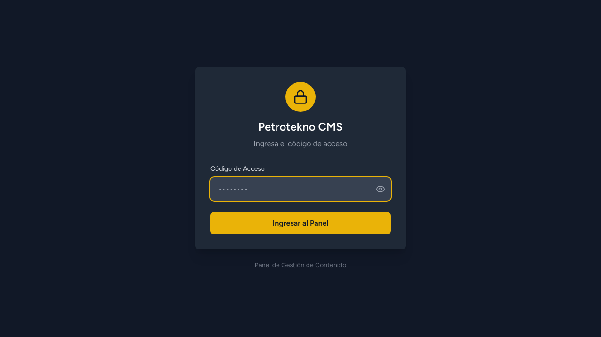
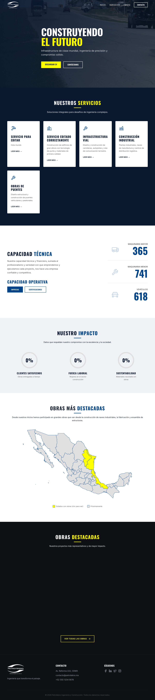
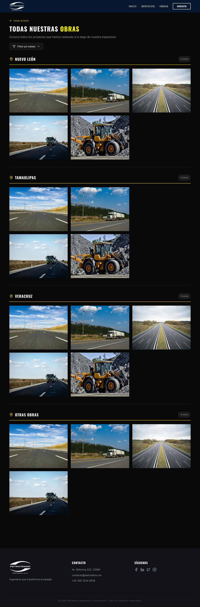
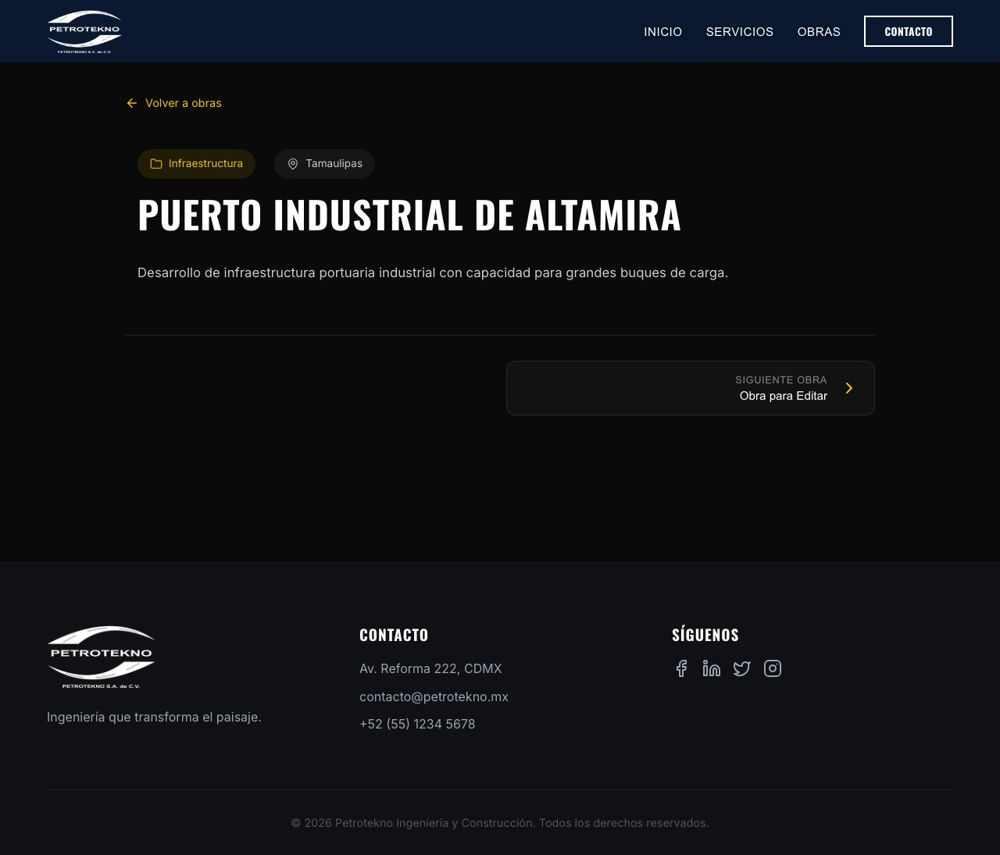
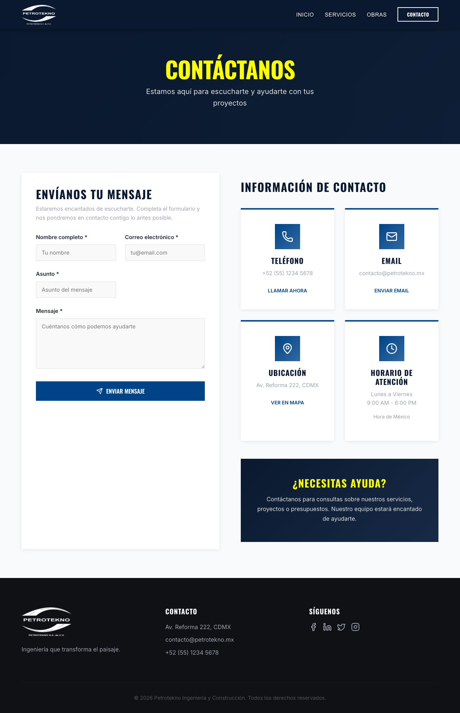

# 🏗️ Petrotekno - Sistema Web Corporativo

> Sistema web integral para empresa de ingeniería y construcción, compuesto por un CMS administrativo y un sitio público de alto rendimiento.


## 📋 Tabla de Contenidos
- [Arquitectura](#-arquitectura)
- [Tecnologías](#-tecnologías)
- [Características](#-características)
- [API REST](#-api-rest)
- [Instalación y Desarrollo](#-instalación-y-desarrollo-local)
- [Scripts Disponibles](#-scripts-disponibles)
- [Deployment](#-deployment)
- [Estructura del Proyecto](#-estructura-del-proyecto)
- [Screenshots](#-screenshots)

## 🏗️ Arquitectura

El proyecto es un monorepo que separa claramente el Backend (API + CMS) del Frontend público.

```ascii
┌─────────────────┐       ┌─────────────────┐       ┌─────────────────┐
│  USUARIO FINAL  │       │   ADMIN PANEL   │       │  BASE DE DATOS  │
│ (Navegador Web) │       │  (Staff Admin)  │       │    (SQLite)     │
└────────┬────────┘       └────────┬────────┘       └────────▲────────┘
         │                         │                         │
         │ HTTP / JSON             │ Inertia.js              │ Eloquent ORM
         ▼                         ▼                         │
┌─────────────────┐       ┌─────────────────┐       ┌────────┴────────┐
│    FRONTEND     │       │     BACKEND     │       │                 │
│  (React + Vite) │◄─────►│ (Laravel API)   │◄─────►│  database.sqlite│
│    Puerto 80    │ REST  │   Puerto 8080   │       │                 │
└─────────────────┘       └─────────────────┘       └─────────────────┘
```

- **Frontend**: SPA construida con React 19 y Vite. Consume la API del backend.
- **Backend**: API RESTful y Panel Administrativo construidos con Laravel 12.
- **Panel Admin**: Interfaz híbrida SPA servida por Laravel usando Inertia.js.

## 🔧 Tecnologías

### Frontend (Público)
- **Core**: React 19, Vite 7, React Router 7
- **UI/UX**: Tailwind CSS, Framer Motion (Animaciones), Lucide React (Iconos)
- **Mapas**: Mapa interactivo SVG de México
- **Servidor**: Nginx (Alpine Linux)

### Backend (CMS & API)
- **Core**: Laravel 12, PHP 8.4
- **Admin UI**: Inertia.js 2.0, React 18, Headless UI
- **Base de Datos**: SQLite (Portable y eficiente)
- **Editor**: Tiptap (WYSIWYG avanzado)
- **Utils**: dnd-kit (Drag & Drop), Intervention Image

## ✨ Características

### 🔐 Backend CMS
- 🏗️ **Gestión de Obras**: CRUD completo, editor de contenido rico, categorización.
- 🛠️ **Gestión de Servicios**: Administración de catálogo de servicios.
- 🖼️ **Sistema de Uploads**: Carga de imágenes optimizada y gestión de archivos.
- 🖱️ **Drag & Drop**: Reordenamiento visual de elementos.
- 🌑 **Dark Mode**: Interfaz administrativa con soporte para modo oscuro.
- ⚙️ **Configuración Global**: Gestión de SEO, redes sociales y datos de contacto.

### 🌐 Frontend Público
- 🚀 **Showcase de Proyectos**: Galería filtrable y optimizada.
- 🗺️ **Mapa Interactivo**: Visualización de obras por estado en mapa de México.
- 📱 **Responsive Design**: Adaptado a móviles, tablets y escritorio.
- ⚡ **Alto Rendimiento**: Carga rápida gracias a Vite y optimización de assets.
- 📨 **Página de Contacto**: Información integrada con configuración del CMS.

## 🔌 API REST

Endpoints públicos disponibles en el Backend (`/api`).

| Método | Endpoint | Descripción |
|--------|----------|-------------|
| `GET` | `/api/obras` | Lista de obras. Params: `destacado`, `estado`, `limit`. |
| `GET` | `/api/obras/por-estado` | Estadísticas de obras agrupadas por estado. |
| `GET` | `/api/obras/{slug}` | Detalle completo de una obra específica. |
| `GET` | `/api/servicios` | Catálogo completo de servicios. |
| `GET` | `/api/servicios/{slug}` | Detalle de un servicio específico. |
| `GET` | `/api/config` | Configuración pública (SEO, contacto, redes). |
| `GET` | `/api/config/cv-empresa` | Descarga/Visualización del CV corporativo. |

## 🚀 Instalación y Desarrollo Local

### Requisitos Previos
- PHP 8.2+
- Node.js 20+
- Composer
- SQLite3

### 1. Configuración del Backend (CMS)

```bash
cd petrotekno-cms

# Instalar dependencias PHP y Node
composer install
npm install

# Configurar entorno
cp .env.example .env
php artisan key:generate

# Preparar base de datos
touch database/database.sqlite
php artisan migrate --seed

# Iniciar servidor de desarrollo (Laravel + Vite)
composer dev
```
> El backend estará disponible en `http://localhost:8000`.
> **Credenciales Panel Admin**: Código de acceso `petrotekno2024`

### 2. Configuración del Frontend

```bash
cd webpetrotekno

# Instalar dependencias
npm install

# Configurar entorno
cp .env.example .env
# Asegúrate de que VITE_API_URL=http://localhost:8000/api

# Iniciar servidor de desarrollo
npm run dev
```
> El frontend estará disponible en `http://localhost:5173`.

## 📜 Scripts Disponibles

### Backend (`petrotekno-cms/`)
| Comando | Descripción |
|---------|-------------|
| `composer setup` | Instalación inicial completa (deps, key, db, seed). |
| `composer dev` | Inicia servidor Laravel, colas, logs y Vite en paralelo. |
| `composer test` | Ejecuta suite de pruebas PHPUnit. |

### Frontend (`webpetrotekno/`)
| Comando | Descripción |
|---------|-------------|
| `npm run dev` | Inicia servidor de desarrollo Vite. |
| `npm run build` | Compila la aplicación para producción. |
| `npm run preview` | Vista previa local del build de producción. |
| `npm run lint` | Ejecuta validación de código con ESLint. |

## 🚀 Deployment

El proyecto está optimizado para despliegue con **Docker** y **Dokploy**.

Consulta la documentación detallada en la carpeta `docs/`:
- 📘 [Guía de Deployment (Dokploy)](DOKPLOY_DEPLOYMENT_GUIDE.md) - Guía paso a paso.
- ⚡ [Quick Start](QUICK_START.md) - Resumen rápido.
- 🐳 [Docker Setup](DOCKER_README.md) - Detalles de contenedores.
- ✅ [Checklist](DEPLOYMENT_CHECKLIST.md) - Verificación pre-deploy.

**Resumen Rápido:**
1. Configurar VPS con Dokploy.
2. Crear Application Backend (Puerto 8080).
3. Crear Application Frontend (Puerto 80).
4. Configurar variables de entorno.
5. Deploy.

## 📁 Estructura del Proyecto

```
.
├── petrotekno-cms/         # 📦 Backend (Laravel)
│   ├── app/                # Lógica de negocio, Modelos, Controladores
│   ├── database/           # Migraciones y Seeders SQLite
│   ├── resources/js/       # Frontend del Panel Admin (Inertia)
│   ├── routes/             # Definición de rutas API y Web
│   └── tests/              # Tests PHPUnit y Playwright
├── webpetrotekno/          # 🌐 Frontend (React)
│   ├── src/
│   │   ├── components/     # Componentes UI reutilizables
│   │   ├── pages/          # Vistas principales
│   │   └── services/       # Cliente API
│   └── public/             # Assets estáticos
└── docs/                   # 📚 Documentación del proyecto
```

## 📸 Screenshots

### Backend (CMS)

| Dashboard | Editor de Obras |
|-----------|-----------------|
|  |  |

### Frontend (Público)

| Homepage | Mapa Interactivo |
|----------|------------------|
|  |  |

| Detalle de Obra | Contacto |
|-----------------|----------|
|  |  |

## 📄 Licencia

Este proyecto es privado y confidencial. Todos los derechos reservados.
